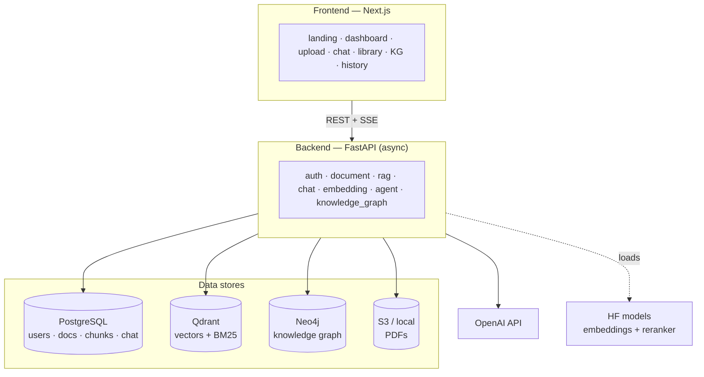
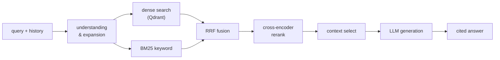

# ResearchMate AI

A production-grade **RAG research assistant** that helps researchers, students, and
engineers understand scientific papers. Upload PDFs, ask grounded questions with
citations, generate summaries, compare papers, explore a knowledge graph, and drive it
all through specialized LLM agents.

Comparable to NotebookLM / Elicit / "Perplexity for research".

---

## Architecture

> 📐 Full set of in-depth diagrams (ingestion, streaming, data model, knowledge graph,
> agents, deployment) lives in **[docs/ARCHITECTURE.md](docs/ARCHITECTURE.md)**.



### RAG pipeline



---

## Tech stack

| Layer            | Choice                                                         |
| ---------------- | -------------------------------------------------------------- |
| Backend          | FastAPI (async), SQLAlchemy 2.0, Pydantic v2                    |
| LLM (default)    | OpenAI GPT (swappable via `LLM_PROVIDER`)                       |
| Embeddings       | BGE / E5 via `sentence-transformers` (swappable)               |
| Reranker         | Cross-encoder (`BAAI/bge-reranker` family)                      |
| Vector DB        | Qdrant (hybrid: dense vectors + BM25 keyword search)           |
| Relational DB    | PostgreSQL (users, documents, chunks, chat memory)             |
| Graph DB         | Neo4j (entities + relations, knowledge graph)                  |
| PDF processing   | PyMuPDF + pdfplumber                                            |
| Frontend         | Next.js (App Router), Tailwind, dark mode, streaming           |
| Auth             | JWT (access + refresh), bcrypt password hashing                |

---

## Quick start (local, Docker Compose)

```bash
# 1. clone + configure
cp .env.example .env
#    → edit .env and set OPENAI_API_KEY

# 2. start infra (postgres + qdrant + neo4j)
docker compose up -d

# 3. backend
cd backend
python -m venv .venv && source .venv/bin/activate
pip install -r requirements.txt
uvicorn app.main:app --reload   # http://localhost:8000/docs

# 4. frontend
cd ../frontend
npm install
npm run dev                     # http://localhost:3000
```

First run downloads the embedding + reranker models from Hugging Face (a few hundred MB).

---

## Project layout

```
ResearchMate-AI/
├── docker-compose.yml         # postgres + qdrant + neo4j
├── .env.example
├── backend/
│   ├── app/
│   │   ├── main.py            # FastAPI app factory
│   │   ├── core/             # config, db, security, logging, deps
│   │   ├── models/          # SQLAlchemy ORM models
│   │   ├── schemas/         # Pydantic request/response models
│   │   ├── services/        # embedding, vectorstore, llm, document,
│   │   │                     #   rag, summarization, comparison,
│   │   │                     #   knowledge_graph, agents
│   │   └── api/v1/           # HTTP endpoints
│   ├── tests/
│   ├── requirements.txt
│   └── Dockerfile
└── frontend/                  # Next.js app
```

---

## Roadmap / status

See the in-repo build. Feature areas: PDF ingestion, hybrid RAG, citations,
summarization, paper comparison, knowledge graph, agents, and full UI.

## License

MIT
