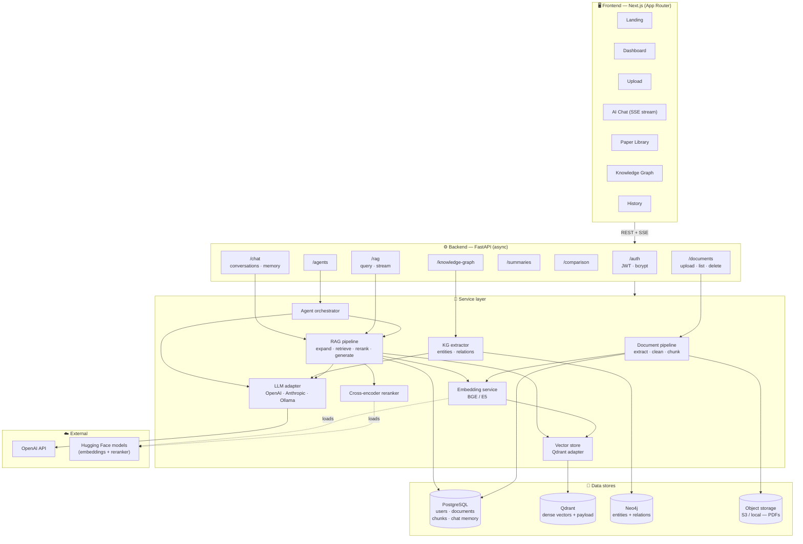
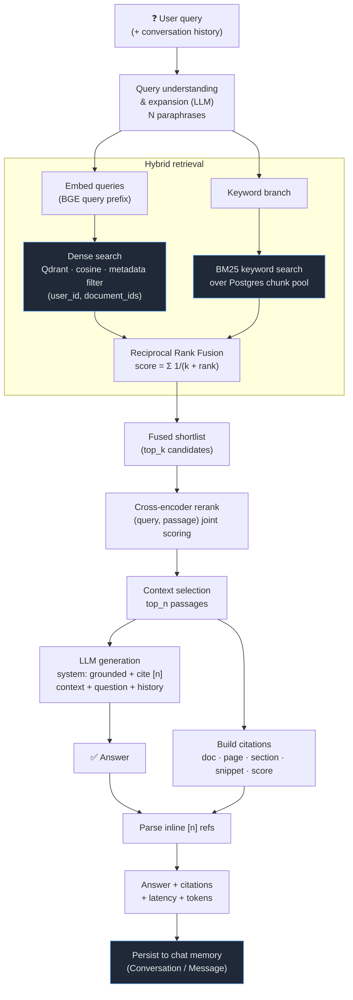
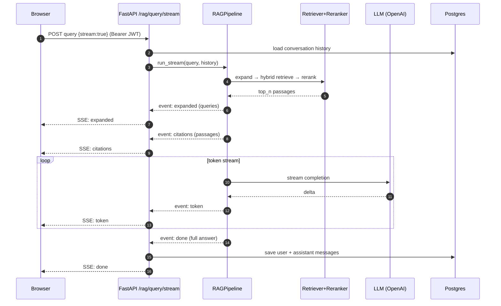
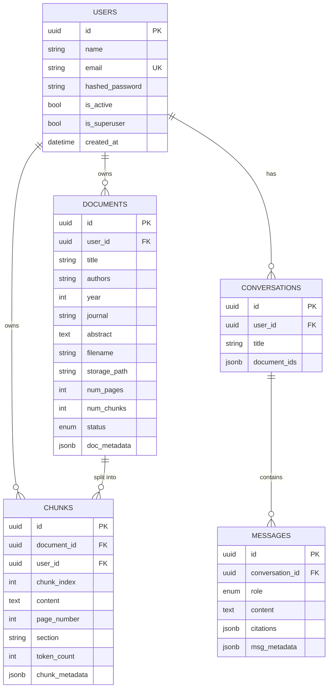
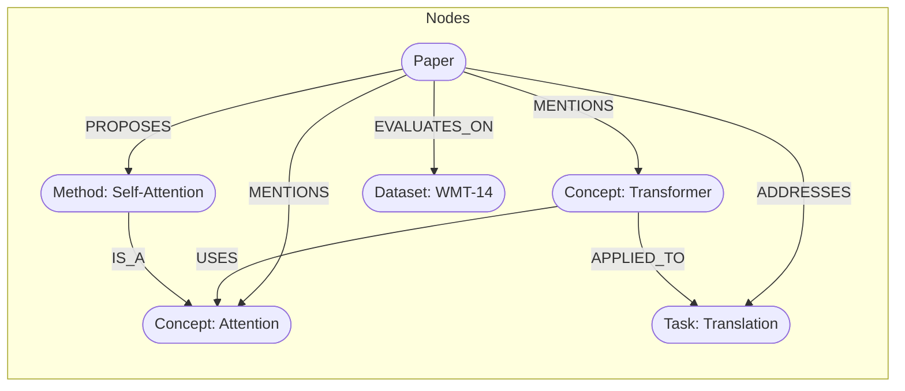
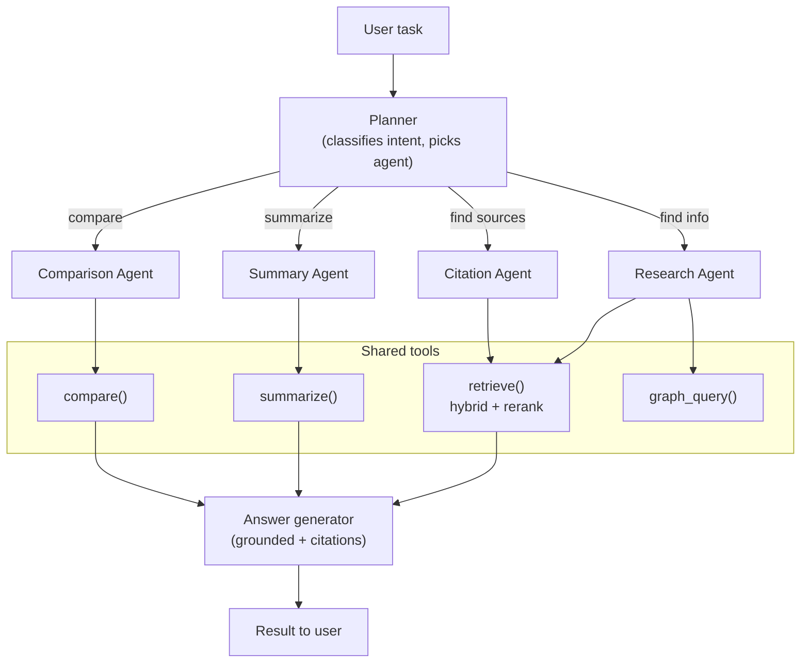
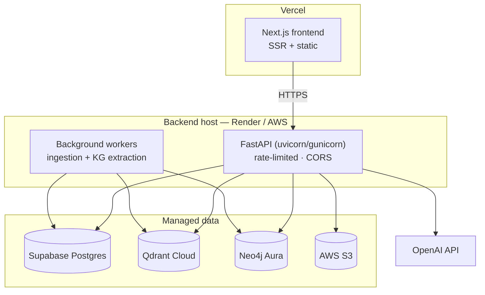

# ResearchMate AI — Architecture

In-depth diagrams of the system, the ingestion pipeline, the RAG query flow, the data
model, the knowledge graph, the agent layer, and the deployment topology.

---

## 1. System architecture (high level)

---

## 2. Document ingestion pipeline

From uploaded PDF to searchable, cited-ready chunks.

```mermaid
flowchart LR
    A["📄 PDF upload"] --> B{"Validate\ntype · size · magic bytes"}
    B -- invalid --> Berr["422 reject"]
    B -- ok --> C["Persist file\nS3 / local storage"]
    C --> D["Create Document row\nstatus = UPLOADED"]
    D --> E["Enqueue background ingest\nstatus = PROCESSING"]

    subgraph Pipeline["DocumentPipeline (thread pool for CPU work)"]
        direction TB
        F["PyMuPDF text extraction\nper-page + metadata"]
        G["pdfplumber tables\n(best-effort)"]
        H["Clean\nstrip headers/footers · de-hyphenate · dedupe"]
        I["Bibliographic metadata\ntitle · authors · year · abstract"]
        J["Semantic chunking\nsection-aware recursive split + overlap"]
        K["Embed chunks\nBGE (doc prefix), normalized"]
    end

    E --> F --> G --> H --> I --> J --> K
    K --> L["Write Chunk rows\n(Postgres = source of truth)"]
    K --> M["Upsert vectors\nQdrant (payload: user/doc/page/section)"]
    L --> N["Document status = READY\nnum_pages · num_chunks"]
    M --> N
    N -.on error.-> O["status = FAILED\nstore error message"]
```

---

## 3. RAG query pipeline (detailed)

The full advanced-RAG path: understanding → expansion → hybrid retrieval → fusion →
reranking → grounded generation with citations.

---

## 4. Streaming answer (SSE) sequence

---

## 5. Relational data model (PostgreSQL)

> Each `CHUNKS` row is mirrored to a Qdrant point keyed by `chunks.id`, so the vector
> index can be rebuilt from Postgres at any time and citations resolve without Qdrant.

---

## 6. Knowledge graph model (Neo4j)

Extraction: the KG extractor prompts the (heavy) LLM per document to emit
`{entities:[{name,type}], relations:[{source,relation,target}]}`, which is merged into
Neo4j with `Paper` provenance so the graph is queryable and visualizable per-user.

---

## 7. Agent orchestration

---

## 8. Deployment topology

